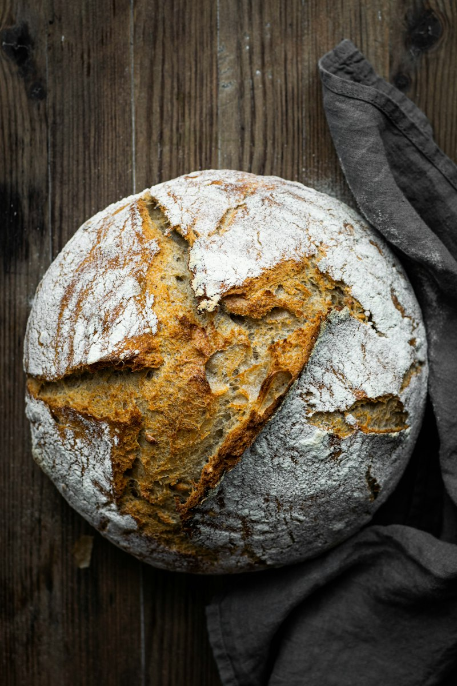

# Ремесленная пекарня «Хлеб & Масло» — Лендинг (Landing-5)

Готовый к запуску, высококонверсионный, адаптивный сайт ремесленной пекарни на живой закваске. Создан в теплой французской винтажной эстетике («French rustic bakery») с теплым кремовым фоном, золотистой корочкой и глубокими древесными тонами.

---

## 📁 Структура проекта

```text
landing-5/
├── index.html       # Семантическая разметка HTML5 с комментариями по замене фото
├── style.css        # Современные стили (CSS Variables, Flex/Grid, адаптивность, анимации)
├── script.js        # Конфигурация LANDING_CONFIG, живой таймер выпечки, корзина, карта, маска телефона
└── README.md        # Настоящее руководство по настройке и редактированию
```

---

## ⚙️ 1. Быстрая настройка контактов и расписания (`script.js`)

Все основные данные сайта централизованы в объекте `LANDING_CONFIG` в самом начале файла `script.js`. Любые изменения здесь автоматически обновляют текст, ссылки, телефон и карту на сайте:

```javascript
const LANDING_CONFIG = {
  brandName: "Хлеб & Масло",
  tagline: "Ремесленная пекарня на дикой закваске",
  phone: "+7 (495) 792-44-18",
  phoneRaw: "+74957924418",            // Телефон без пробелов для ссылок tel:
  email: "bonjour@hlebmaslo.ru",
  address: "Москва, Пречистенский пер., 12",
  metro: "Кропоткинская / Парк Культуры",
  
  // Координаты Яндекс Карт [широта, долгота]
  coordinates: [55.748912, 37.592314],
  mapZoom: 16,
  
  // Часы работы для автоматического виджета «Открыто сейчас»
  workingHours: {
    weekdays: { open: "07:30", close: "21:00" }, // Понедельник - Пятница
    weekends: { open: "08:30", close: "21:30" }  // Суббота - Воскресенье
  },

  // Социальные сети
  socials: {
    telegram: "https://t.me/hleb_maslo_bakery",
    vk: "https://vk.com/hleb_maslo_bakery",
    whatsapp: "https://wa.me/74957924418"
  },

  // Расписание выхода горячих партий из подовой печи
  bakingSchedule: [
    {
      id: "batch-1",
      time: "07:30",
      title: "Утренняя парижская слойка",
      items: "Круассаны сливочные 84%, Пэн-о-шоколя, багеты Традисьон",
      totalLoaves: 36,
      desc: "Первая теплая партия прямо к утреннему кофе. Тесто поднималось всю ночь."
    },
    // ... дополнительные партии
  ]
};
```

---

## 🗺️ 2. Настройка Яндекс Карт

1. Откройте сервис [Яндекс Карты](https://yandex.ru/maps/) и найдите адрес вашей пекарни.
2. Кликните правой кнопкой мыши по точке и скопируйте координаты (например, `[55.748912, 37.592314]`).
3. Вставьте координаты в параметр `coordinates` в `script.js`.
4. В файле `index.html` при необходимости укажите ваш собственный API-ключ в строке:
   ```html
   <script src="https://api-maps.yandex.ru/2.1/?apikey=ВАШ_API_КЛЮЧ&lang=ru_RU" type="text/javascript"></script>
   ```
   *(Если ключ не указан, базовый скрипт Яндекс Карт 2.1 работает для локального тестирования и стандартных сайтов).*
5. Если карта не может загрузиться (например, отключен интернет или блокировщик рекламы), автоматически отобразится стилизованный блок-заглушка с прямой ссылкой в приложение Яндекс Карты.

---

## 📸 3. Как заменить фотографии

В `index.html` все изображения снабжены поясняющими комментариями вида:
`<!-- КАК ЗАМЕНИТЬ ФОТО: Замените src на images/... -->`

### Шаги для замены:
1. Создайте внутри папки `landing-5` подпапку `images/`.
2. Поместите туда ваши фотографии (рекомендуется формат `.jpg` или `.webp`, оптимизированные до 150–350 Кб).
3. В файле `index.html` замените интернет-ссылки Unsplash на относительные пути к вашим файлам:
   - Главное фото первого экрана (Hero):  
     Замените `https://images.unsplash.com/photo-1509440159596-0249088772ff...`  
     на `images/hero-bakery.jpg`
   - Тартин классический: `images/tartine-classic.jpg`
   - Бородинский хлеб: `images/rye-borodino.jpg`
   - Французский багет: `images/french-baguette.jpg`
   - Круассан сливочный: `images/croissant-butter.jpg`
   - Миндальный круассан: `images/croissant-almond.jpg`
   - Шоколатин: `images/pain-au-chocolat.jpg`
   - Бриошь Нантер: `images/brioche-nanterre.jpg`
   - Булочка с корицей: `images/cinnamon-bun.jpg`
   - Сельский хлеб с семенами: `images/seeded-country.jpg`
   - Взбитое масло: `images/whipped-butter.jpg`
   - Фокачча: `images/focaccia-rosemary.jpg`
   - Фото пекаря в блоке «О пекарне»: `images/baker-craft.jpg`
   - Фото мякиша: `images/bread-crumb.jpg`

---

## 🥐 4. Добавление и изменение позиций в меню

Каждая карточка товара в `index.html` имеет следующую структуру:

```html
<article class="product-card" data-category="sourdough" data-id="tartine-classic">
  <div class="product-card__thumb">
    
    <span class="product-badge product-badge--amber">Хит пекарни</span>
  </div>
  <div class="product-card__body">
    <div class="product-card__meta">
      <span class="product-meta__weight">850 г</span>
      <span class="product-meta__ferment">36 ч ферментация</span>
    </div>
    <h3 class="product-card__title">Тартин пшеничный «Традисьон»</h3>
    <p class="product-card__desc">Описание вкуса, корочки и мякиша...</p>
    <div class="product-card__ingredients">Состав: мука пшеничная, вода, закваска, соль.</div>
    <div class="product-card__footer">
      <div class="product-card__price">390 ₽</div>
      <div class="product-card__action" data-product-control="tartine-classic">
        <button class="btn btn--outline btn--add" data-action="add" data-id="tartine-classic" data-name="Тартин пшеничный «Традисьон»" data-price="390">
          + В предзаказ
        </button>
      </div>
    </div>
  </div>
</article>
```

### Категории товаров для фильтров (`data-category`):
- `sourdough` — Подовый ремесленный хлеб на закваске
- `viennoiserie` — Французская слоёная выпечка (круассаны, шоколатины)
- `pastry` — Сдоба, бриоши и булочки
- `butter` — Фермерское масло и домашние намазки

---

## 🛍️ 5. Интерактивная корзина и расчет подарков

- При клике на кнопку «+ В предзаказ» на карточке товара появляется интерактивный счетчик количества `[- 1 +]`.
- В правом верхнем углу шапки увеличивается счетчик позиций.
- Снизу экрана всплывает фиксированная плашка с суммой заказа и подсказкой о подарке:  
  *При сумме заказа от 2000 ₽ автоматически добавляется подарок — баночка фирменного взбитого масла с солью Fleur de Sel.*
- При клике на корзину открывается модальное окно с перечнем позиций, прогресс-баром подарка, выбором времени самовывоза или доставки и формой оформления.

---

## 📞 6. Форма предзаказа и маска телефона

- Поле номера телефона имеет строгую маску для российских номеров: `+7 (___) ___-__-__`.
- При отправке выполняется валидация имени, длины телефона и согласия с политикой конфиденциальности.
- При успешной отправке отображается экран подтверждения с индивидуальным номером заказа (например, `#HM-4821`), детализацией позиций и инструкцией.
- Для отправки данных в вашу CRM или Telegram-бота просто добавьте fetch-запрос в функцию `handleOrderSubmit` в файле `script.js`.

---

## 🎨 7. Цветовая палитра проекта

| Название тона | HEX-код | Назначение |
|---|---|---|
| **Warm flour cream** | `#FFFDF7` | Основной фон сайта, карточки |
| **Crust golden amber** | `#C98A35` | Главный акцент, золотистая корочка, кнопки, бейджи |
| **Warm wood brown** | `#4A2E1B` | Заголовки Cormorant Garamond, темный контраст |
| **Olive leaf** | `#626B50` | Вторичный акцент, натуральные теги, иконки |
| **Soft butter** | `#FDECC8` | Фон плашек, мягкий сливочный тон, бейджи |
| **Deep wood dark** | `#2E1B0F` | Подвал (футер), глубокий контраст |

---

## 🚀 8. Запуск и публикация

Лендинг полностью статичен и не требует backend-сервера или сборщиков Webpack/Vite:
1. Для локального просмотра достаточно открыть `index.html` в любом браузере (или через расширение Live Server в VS Code).
2. Для публикации в интернете загрузите файлы в корень любого веб-сервера (Nginx, Apache), либо на бесплатные платформы:
   - **GitHub Pages** (Settings -> Pages -> Branch main)
   - **Vercel** / **Netlify** (drag-and-drop папки `landing-5`)
   - **Beget / Timeweb / Reg.ru** (в папку `public_html`).
